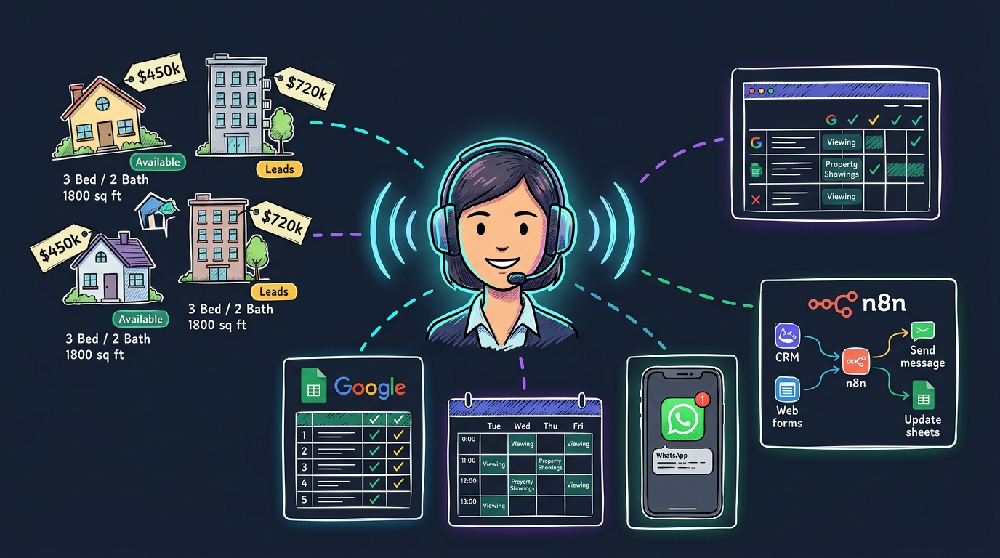
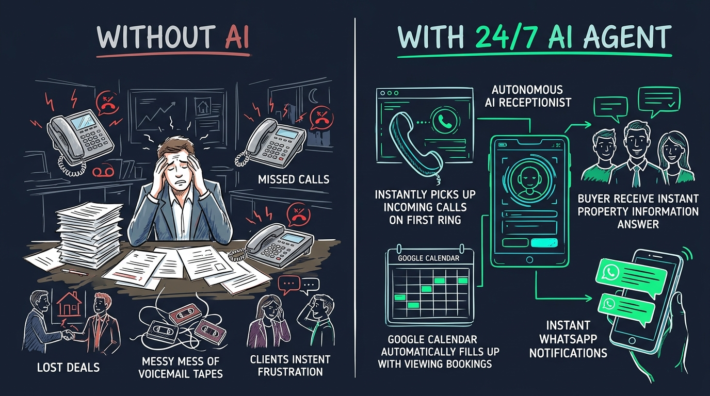
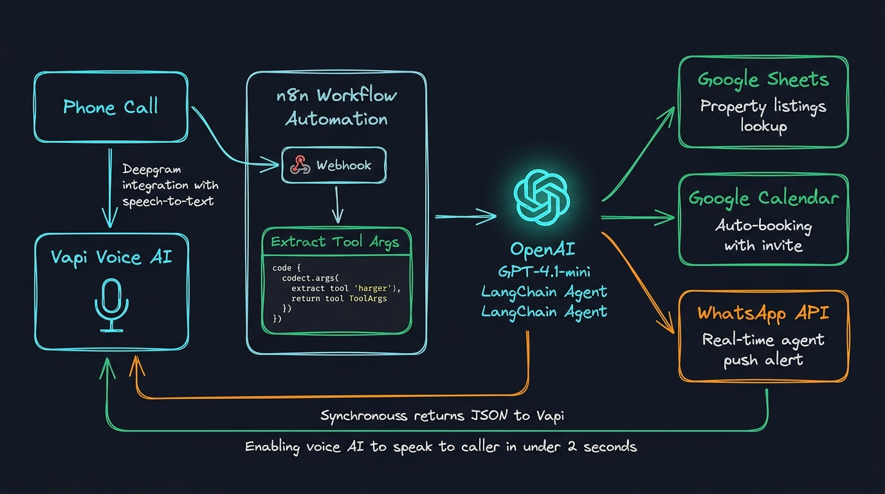
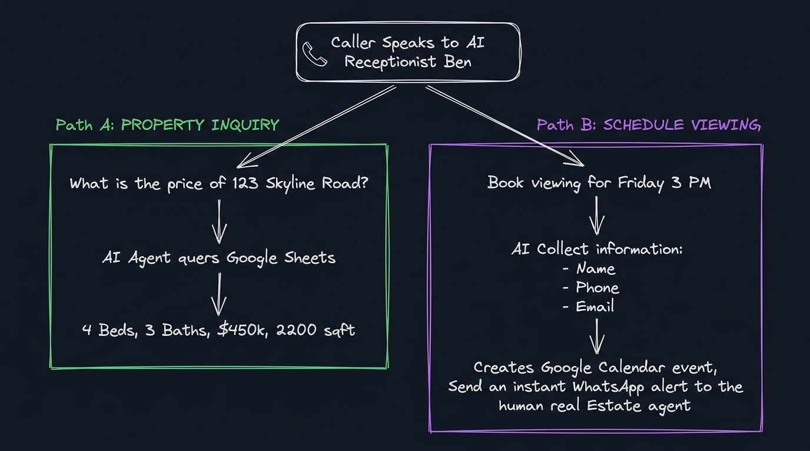

<div align="center">

  

  <br />
  <br />

  # 📞 AI Voice Calling Agent — Real Estate Automation

  <p align="center">
    <strong>An autonomous 24/7 AI voice receptionist that fields inbound property inquiries from live Google Sheets listings and books viewing appointments directly into Google Calendar with instant WhatsApp agent notifications.</strong>
  </p>

  <p align="center">
    <a href="https://n8n.io"></a>
    <a href="https://vapi.ai"></a>
    <a href="https://openai.com"></a>
    <a href="https://deepgram.com"></a>
    <a href="https://workspace.google.com"></a>
    <a href="https://developers.facebook.com/docs/whatsapp"></a>
    <a href="LICENSE"></a>
  </p>

  <p align="center">
    <strong>⚡ Round-Trip Latency: &lt; 2s</strong> &nbsp;|&nbsp;
    <strong>💰 Operating Cost: ~$0.11 / min</strong> &nbsp;|&nbsp;
    <strong>🕒 Availability: 24/7/365</strong> &nbsp;|&nbsp;
    <strong>🎯 Lead Capture Rate: 100%</strong>
  </p>

  <p align="center">
    <a href="#why-this-exists">Why This Exists</a> •
    <a href="#architecture">Architecture</a> •
    <a href="#conversational-flow">Conversational Flow</a> •
    <a href="#live-demo">Live Call Demo</a> •
    <a href="#tech-stack">Tech Stack</a> •
    <a href="#workflow-nodes">Workflow Nodes</a> •
    <a href="#database-schema">Database Schema</a> •
    <a href="#setup-guide">Setup Guide</a> •
    <a href="#vapi-schema">Vapi Schema</a> •
    <a href="#use-cases">Use Cases</a>
  </p>

</div>

---

<a id="why-this-exists"></a>
## 💡 Why This Exists: The Problem vs. The AI Solution

In real estate sales and property management, **speed-to-lead dictates conversion**. Industry data shows that **over 62% of property inquiries occur during evenings, weekends, and holidays**. When an eager home buyer calls and hits voicemail, more than **70% never leave a message** — they hang up and dial the competing brokerage.

Human front desks and answering services face steep structural trade-offs:
* **Costly overhead**: Traditional receptionists cost $3,000–$4,500/month and only cover 8–9 hours a day.
* **Call triage delays**: Answering services take notes that sit in email inboxes for hours before an agent follows up.
* **Information friction**: Callers demand immediate answers about pricing, bedroom counts, and available tour times.

This project delivers an **autonomous, low-latency AI receptionist ("Ben")** who answers every call on the first ring, queries live listing data from Google Sheets in real-time, schedules confirmed tours into Google Calendar, and alerts the listing agent over WhatsApp in seconds.

<div align="center">
  
</div>

### 📊 Performance & Operational Benchmarks

| Metric / Capability | Traditional Brokerage (Without AI) | Autonomous AI Voice Calling Agent | Tangible Business Advantage |
| :--- | :--- | :--- | :--- |
| **First Ring Pickup** | 3–5 rings, voicemail, or hold music | **Instant pickup (< 1 second)** | Zero abandoned calls; 100% capture rate |
| **Operational Hours** | Mon–Fri, 9:00 AM – 5:30 PM | **24/7/365 continuous uptime** | Captures prime evening and weekend buyers |
| **Inventory Accuracy** | Dependent on memory / stale printouts | **Live queries to Google Sheets** | Zero hallucinations on price, beds, or sqft |
| **Appointment Booking** | 3–5 emails or back-and-forth SMS tag | **Instant Google Calendar reservation** | Calendar automatically books confirmed slots |
| **Agent Notification** | Unchecked voicemail batches | **Instant WhatsApp lead dossier push** | Realtor receives buyer profile in seconds |
| **Round-Trip Latency** | Minutes to hours | **< 2 seconds end-to-end** | Fluid, human-grade conversational cadence |
| **Operating Cost** | $3,000+ / month fixed salary | **~$0.11 / minute active talk time** | Over 90% savings in administrative overhead |

<div align="right">
  <a href="#-ai-voice-calling-agent--real-estate-automation">▲ Back to Top</a>
</div>

---

<a id="architecture"></a>
## 🏗️ System Architecture & Workflow Blueprint

The system bridges ultra-low latency conversational telephony (**Vapi**) with an enterprise-grade backend automation runtime (**n8n**), orchestrated by a **LangChain AI Agent** and **OpenAI GPT-4.1-mini**.

<div align="center">
  
</div>

### ⚙️ Step-by-Step Technical Execution Loop:

```
[Inbound Phone Call]
        │
        ▼
[Vapi Voice AI] ─── (Streaming STT: Deepgram Nova-2 & TTS: Elliot)
        │
        ├── HTTP POST (Structured JSON Webhook)
        ▼
[n8n Webhook Node] ─── (/webhook/bcb238ed-fc58-4303-8bd6-94366023f289)
        │
        ▼
[Extract Tool Args] ─── (Normalizes toolCallList, Type, property details, caller info)
        │
        ▼
[LangChain AI Agent] ◄───► [OpenAI GPT-4.1-mini] (Zero-shot tool planner)
        │
        ├── [Path A] ──► [Google Sheets Tool] ──► Query "Real Estate Properties" Sheet
        │
        └── [Path B] ──► [Google Calendar Tool] ──► Book Slot & Add Invitee Email
                     └──► [WhatsApp Cloud API] ──► Push Realtor Instant Alert
        │
        ▼
[Respond to Webhook] ─── (Synchronous JSON: { results: [{ toolCallId, result }] })
        │
        ▼
[Vapi Voice AI Speaks Confirmation to Caller]
```

1. **Voice Ingress & Telephony**:
   * The prospective buyer dials the assigned phone number.
   * **Vapi** connects the stream instantly, utilizing **Deepgram Nova-2** for streaming Speech-to-Text (STT) and voice model **Elliot** for high-fidelity Text-to-Speech (TTS).
2. **Intent Classification & Webhook Dispatch**:
   * When caller intent triggers a tool action, Vapi issues a synchronous HTTP `POST` request containing a structured `toolCallList` payload to the **n8n Webhook** endpoint (`path: bcb238ed-fc58-4303-8bd6-94366023f289`).
   * The webhook operates with `responseMode: "responseNode"`, keeping the socket open while tools execute.
3. **Parameter Normalization (`Extract Tool Args`)**:
   * A native JavaScript **Code Node** parses `toolCallList`, extracting `toolCallId`, intent `Type` (`"Property search"` or `"Viewing booking"`), property search query, caller name, email, phone number, viewing time, and address.
4. **LangChain Agent Reasoning & Multi-Tool Routing**:
   * The **AI Agent** (`@n8n/n8n-nodes-langchain.agent` v3.1) receives the normalized prompt and delegates to **OpenAI GPT-4.1-mini**:
     * 📊 **Google Sheets Tool**: Queries the live inventory spreadsheet by address, extracting exact bedrooms, bathrooms, price, square footage, and description.
     * 📅 **Google Calendar Tool**: Auto-creates an event on the agent's Google Calendar (`laravelpractice4@gmail.com`) with the venue address, start/end timestamps, and caller attendee email.
     * 💬 **WhatsApp Cloud API Tool**: Dispatches an instant WhatsApp lead alert with the caller's complete booking details to the listing agent (`+923182227655`).
5. **Synchronous Return Loop**:
   * The **Respond to Webhook** node maps all resolved agent outputs to Vapi's expected schema: `{ "results": [{ "toolCallId": "...", "result": "..." }] }`.
   * Vapi immediately streams the spoken answer back to the caller in **under 2 seconds**.

<div align="right">
  <a href="#-ai-voice-calling-agent--real-estate-automation">▲ Back to Top</a>
</div>

---

<a id="conversational-flow"></a>
## 🔄 Dual-Intent Conversational Decision Flow

The agent features state-aware conversational branching to handle property exploration and viewing appointments without losing call context:

<div align="center">
  
</div>

```
                            ┌───────────────────────────────────────────────┐
                            │    📞 Inbound Call Answered (< 1 second)      │
                            │         AI Receptionist Ben Greets Caller     │
                            └───────────────────────┬───────────────────────┘
                                                    │
                                                    ▼
                                     Determine Primary Caller Intent
                                                    │
                        ┌───────────────────────────┴───────────────────────────┐
                        ▼                                                       ▼
          [PATH A: PROPERTY INQUIRY]                              [PATH B: VIEWING BOOKING]
    Caller asks about a specific address                     Caller requests an in-person viewing
    (e.g., "What is the price of 123 Skyline?")              (e.g., "Can I tour 123 Skyline on Friday?")
                        │                                                       │
                        ▼                                                       ▼
    Vapi dispatches "Property search" tool call              AI prompts for Name, Email, Phone, Time
                        │                                                       │
                        ▼                                                       ▼
    n8n AI Agent invokes Google Sheets Tool                  Vapi dispatches "Viewing booking" tool call
                        │                                                       │
                        ▼                                                       ▼
    Retrieves live listing records:                          n8n AI Agent executes 2 actions in parallel:
    • Beds, Baths, Sqft, Price, Notes                        1. Google Calendar: Creates scheduled event
                        │                                    2. WhatsApp: Sends lead dossier to realtor
                        ▼                                                       │
    AI speaks property details naturally                     AI confirms booking over the phone &
    & asks: "Would you like to schedule a tour?"             mentions calendar invite has been emailed
```

<div align="right">
  <a href="#-ai-voice-calling-agent--real-estate-automation">▲ Back to Top</a>
</div>

---

<a id="live-demo"></a>
## 🎙️ Real-World Walkthrough & Live Call Simulation

Here is a realistic transcript of an inbound buyer call handled completely autonomously from greeting to calendar booking:

```
[00:01] 📞 Phone Rings — Ben (AI Receptionist) picks up on the 1st ring.
[00:02] 🤖 Ben (AI): "Thanks for calling Horizon Realty! My name is Ben. 
                      Are you looking to inquire about a listing, or book a viewing today?"
[00:07] 👤 Caller:   "Hi Ben, could you tell me about the house at 123 Skyline Road?"

                      ─── [BACKEND] n8n Webhook Ingress ───
                      • Inbound Tool: real_estate_tool
                      • Type: "Property search"
                      • Details: "123 Skyline Road"
                      • Tool Node: Google Sheets
                      • Query Result: 4 Bed | 3 Bath | 2,200 sqft | $450,000 | Available
                      ─────────────────────────────────────

[00:09] 🤖 Ben (AI): "That's a fantastic home! 123 Skyline Road is a 4-bedroom, 3-bathroom 
                      property with 2,200 square feet, listed at $450,000. It features an 
                      updated chef's kitchen and an attached 2-car garage. 
                      Would you like to schedule an in-person viewing?"
[00:20] 👤 Caller:   "Yes please, how about this Friday at 3 PM?"
[00:24] 🤖 Ben (AI): "I can certainly arrange that! May I have your full name, phone number, 
                      and the best email to send your calendar invite to?"
[00:32] 👤 Caller:   "Sarah Jenkins, 555-0199, and sarah.jenkins@example.com."

                      ─── [BACKEND] n8n AI Agent Dual-Tool Execution ───
                      • Node: Google Calendar Tool
                        → Event: "Property Viewing - 123 Skyline Road"
                        → Time: Friday, 3:00 PM - 4:00 PM
                        → Location: "123 Skyline Road, Austin, TX"
                        → Attendee: sarah.jenkins@example.com
                      • Node: WhatsApp Business API Tool
                        → Recipient: Agent (+92 318 2227655)
                        → Body: "🚨 New Viewing Confirmed!
                                 • Lead: Sarah Jenkins (555-0199)
                                 • Email: sarah.jenkins@example.com
                                 • Property: 123 Skyline Road
                                 • Time: Friday at 3:00 PM"
                      ─────────────────────────────────────────────────

[00:35] 🤖 Ben (AI): "You're all set, Sarah! We have you confirmed for 123 Skyline Road this Friday 
                      at 3:00 PM. A calendar invite has been sent to your email, and our listing agent 
                      has been notified. We look forward to meeting you!"
[00:46] 📞 Call Successfully Concluded (< 50 seconds total elapsed time).
```

<div align="right">
  <a href="#-ai-voice-calling-agent--real-estate-automation">▲ Back to Top</a>
</div>

---

<a id="tech-stack"></a>
## 🛠️ Tech Stack & Integration Ecosystem

| Technology / Service | Category | Technical Role in System | Documentation |
| :--- | :--- | :--- | :--- |
| **[Vapi](https://vapi.ai)** | Voice AI Telephony | Inbound call SIP trunking, turn detection, WebRTC streaming, and function tool calling. | [docs.vapi.ai](https://docs.vapi.ai) |
| **[Deepgram Nova-2](https://deepgram.com)** | Speech-to-Text (STT) | Ultra-low-latency real-time voice transcription optimized for noisy phone audio and accents. | [deepgram.com/docs](https://developers.deepgram.com) |
| **[n8n](https://n8n.io)** | Workflow Automation | Core orchestration server; executes secure webhooks, custom JavaScript logic, and LangChain nodes. | [docs.n8n.io](https://docs.n8n.io) |
| **[OpenAI GPT-4.1-mini](https://openai.com)** | Language Model | High-speed, cost-efficient reasoning engine for zero-shot tool selection and parameter extraction. | [platform.openai.com](https://platform.openai.com/docs) |
| **[Google Sheets API v4](https://workspace.google.com/products/sheets/)** | Live Database | Serverless property inventory repository updated by non-technical staff without code redeployment. | [developers.google.com/sheets](https://developers.google.com/sheets) |
| **[Google Calendar API v3](https://workspace.google.com/products/calendar/)** | Schedule Management | Automated calendar event reservation, conflict-free booking, and automated attendee invitations. | [developers.google.com/calendar](https://developers.google.com/calendar) |
| **[Meta WhatsApp Cloud API](https://developers.facebook.com/docs/whatsapp)** | Messaging Push | Direct-to-mobile real-time alerts delivering lead dossiers to real estate agents within 3 seconds. | [developers.facebook.com](https://developers.facebook.com/docs/whatsapp/cloud-api) |

<div align="right">
  <a href="#-ai-voice-calling-agent--real-estate-automation">▲ Back to Top</a>
</div>

---

<a id="workflow-nodes"></a>
## 🧩 Workflow Node 1-to-1 Breakdown

The entire production pipeline is defined inside [`main-workflow.json`](main-workflow.json). Every node is mapped below with its exact configuration and responsibility:

| Node Name | Node Type | Version | Execution Role | Configuration Highlights |
| :--- | :--- | :---: | :--- | :--- |
| **Webhook** | `n8n-nodes-base.webhook` | `2.1` | Inbound listener | HTTP `POST` at `/webhook/bcb238ed-fc58-4303-8bd6-94366023f289`. `responseMode: "responseNode"` holds the HTTP socket open until downstream nodes complete. |
| **Extract Tool Args** | `n8n-nodes-base.code` | `2.0` | Data transformation | JavaScript function node that flattens `body.message.toolCallList[]`, mapping `toolCallId`, `Type`, `Property search details`, `Name`, `Email`, `Phone`, `Viewing_Time`, and `Booking_address`. |
| **AI Agent** | `@n8n/n8n-nodes-langchain.agent` | `3.1` | Decision engine | LangChain Agent using `define` prompt mode. Evaluates parsed call arguments and routes to connected AI tools based on explicit system rules. |
| **OpenAI Chat Model** | `@n8n/n8n-nodes-langchain.lmChatOpenAi` | `1.3` | Model binding | Supplies `gpt-4.1-mini` to the AI Agent via `openAiApi` credentials for low-latency reasoning and structured tool calls. |
| **Google Sheets** | `n8n-nodes-base.googleSheetsTool` | `4.7` | Inventory search tool | Connected as an AI tool. Searches document `Real Estate Properties` (`15qXJ1gGq0Yc_RgkXUxO-SVjezJPOezDHltjqV5GxeAw`, `Sheet1`) by address. |
| **Google Calendar** | `n8n-nodes-base.googleCalendarTool` | `1.3` | Booking tool | Connected as an AI tool. Dynamically schedules viewing slots on target calendar (`laravelpractice4@gmail.com`) using `$fromAI('Start')` and `$fromAI('End')`. |
| **Send message in WhatsApp** | `n8n-nodes-base.whatsAppTool` | `1.1` | Realtor alert tool | Connected as an AI tool. Sends an instant WhatsApp message from Phone Number ID `1124222250772706` to recipient `+923182227655`. |
| **Respond to Webhook** | `n8n-nodes-base.respondToWebhook` | `1.5` | Egress response | Compiles agent execution outputs into Vapi format: `{ "results": [{ "toolCallId": "...", "result": "..." }] }` with `executeOnce: true`. |

<div align="right">
  <a href="#-ai-voice-calling-agent--real-estate-automation">▲ Back to Top</a>
</div>

---

<a id="database-schema"></a>
## 📊 Google Sheets Inventory Blueprint

To connect your own property catalog, create a Google Spreadsheet titled **`Real Estate Properties`** with the following column structure on `Sheet1`:

| Column | Header Name | Data Type | Example Value | Function in Agent Pipeline |
| :---: | :--- | :--- | :--- | :--- |
| **A** | `Address` | `String` | `123 Skyline Road, Austin, TX` | **Primary Key** matched against caller's speech |
| **B** | `Bedrooms` | `Integer` | `4` | Spoken when caller asks about size or layout |
| **C** | `Bathrooms` | `Integer` | `3` | Spoken when caller inquires about amenities |
| **D** | `Price` | `String` | `$450,000` | Quoted when caller asks for listing price |
| **E** | `Square Footage` | `String` | `2,200 sq ft` | Quoted when caller asks for property dimensions |
| **F** | `Status` | `String` | `Available` | Filter: `Available`, `Pending Under Contract`, `Sold` |
| **G** | `Description` | `String` | `Renovated kitchen, fenced yard, 2-car garage` | Spoken highlights delivered to the caller |

> [!TIP]
> **Live Updates Without Redeployment**: When prices drop, properties go under contract, or new listings are added, simply edit your Google Sheet. The AI agent queries the spreadsheet dynamically on every phone call — no code restarts, migrations, or cache purges required.

<div align="right">
  <a href="#-ai-voice-calling-agent--real-estate-automation">▲ Back to Top</a>
</div>

---

<a id="setup-guide"></a>
## 🚀 Step-by-Step Deployment & Setup Guide

### 1. Prerequisites Checklist
Before configuring the system, ensure you have:
* An **[n8n](https://n8n.io/)** instance running (v1.30+ or n8n Cloud).
* An **[OpenAI Platform](https://platform.openai.com/)** API Key with `gpt-4.1-mini` access.
* A **[Google Cloud Console](https://console.cloud.google.com/)** project with OAuth2 enabled for **Google Sheets** and **Google Calendar**.
* A **[Meta for Developers](https://developers.facebook.com/)** account with a configured WhatsApp Cloud API phone number.
* A **[Vapi Dashboard](https://dashboard.vapi.ai/)** account with a purchased phone number.

---

### 2. Import Workflow into n8n

1. Clone or download this repository:
   ```bash
   git clone https://github.com/Harmain89/ai-voice-calling-agent-n8n.git
   cd ai-voice-calling-agent-n8n
   ```
2. Open your n8n workspace.
3. Click **Workflows** → **Add Workflow** (or use keyboard shortcut `Ctrl+O` / `Cmd+O`).
4. Click the three dots icon (`⋮`) in the top-right corner → select **Import from File**.
5. Select [`main-workflow.json`](main-workflow.json).
6. The entire workflow canvas will populate with all 8 nodes and connections preserved.

---

### 3. Connect Credentials in n8n

Open the corresponding nodes in n8n and link your accounts:

* **OpenAI Chat Model**: Add your OpenAI API Key under `openAiApi`.
* **Google Sheets Tool**: Authorize OAuth2 access and link your `Real Estate Properties` spreadsheet.
* **Google Calendar Tool**: Authorize OAuth2 access and set the target agent calendar (`laravelpractice4@gmail.com`).
* **WhatsApp Tool**: Enter your WhatsApp Cloud API Permanent Access Token, verify `phoneNumberId` (`1124222250772706`), and set the target agent recipient number (`+923182227655`).

---

### 4. Configure Vapi Voice Assistant

1. In your **[Vapi Dashboard](https://dashboard.vapi.ai/)**, navigate to **Assistants** → **Create Assistant**.
2. Set the assistant name to `Ben - Real Estate Receptionist`.
3. Configure the Voice settings:
   * **Transcriber**: `Deepgram` | Model: `Nova-2`
   * **Voice Provider**: `Vapi / 11labs` | Voice: `Elliot`
4. Set the **Server URL** to your n8n Webhook Production URL:
   ```
   https://your-n8n-domain.com/webhook/bcb238ed-fc58-4303-8bd6-94366023f289
   ```
5. Register the tool function using the JSON schema provided in the section below.
6. Toggle the n8n workflow to **Active** (production mode) and place a live test call!

<div align="right">
  <a href="#-ai-voice-calling-agent--real-estate-automation">▲ Back to Top</a>
</div>

---

<a id="vapi-schema"></a>
## 📋 Ready-to-Use Vapi Tool Schema & Payloads

### 1. Vapi Tool Function Definition
Register this function definition in your Vapi Assistant tool configuration:

```json
{
  "type": "function",
  "function": {
    "name": "real_estate_tool",
    "description": "Queries real-time property listing details and schedules in-person viewing appointments.",
    "parameters": {
      "type": "object",
      "properties": {
        "Type": {
          "type": "string",
          "enum": ["Property search", "Viewing booking"],
          "description": "Specifies whether the caller is requesting listing info or booking a viewing."
        },
        "Property search details": {
          "type": "string",
          "description": "The street address, unit number, or neighborhood the caller is inquiring about."
        },
        "Name": {
          "type": "string",
          "description": "Full legal name of the caller booking the appointment."
        },
        "Email": {
          "type": "string",
          "description": "Email address of the caller for receiving the Google Calendar confirmation."
        },
        "Phone": {
          "type": "string",
          "description": "Direct contact phone number for the caller."
        },
        "Viewing_Time": {
          "type": "string",
          "description": "Requested appointment date and time (e.g. 'Friday at 3:00 PM' or ISO 8601 string)."
        },
        "Booking_address": {
          "type": "string",
          "description": "The physical address of the listing to be viewed."
        }
      },
      "required": ["Type"]
    }
  }
}
```

### 2. Inbound Vapi Webhook Payload (to n8n)
```json
{
  "message": {
    "type": "tool-calls",
    "toolCallList": [
      {
        "id": "call_vapi_98234xyz",
        "type": "function",
        "function": {
          "name": "real_estate_tool",
          "arguments": {
            "Type": "Viewing booking",
            "Name": "Sarah Jenkins",
            "Phone": "555-0199",
            "Email": "sarah.jenkins@example.com",
            "Viewing_Time": "Friday at 3:00 PM",
            "Booking_address": "123 Skyline Road"
          }
        }
      }
    ]
  }
}
```

### 3. Synchronous n8n Response Payload (to Vapi)
```json
{
  "results": [
    {
      "toolCallId": "call_vapi_98234xyz",
      "result": "The viewing for 123 Skyline Road is confirmed for Friday at 3:00 PM. A calendar invitation has been sent to sarah.jenkins@example.com."
    }
  ]
}
```

<div align="right">
  <a href="#-ai-voice-calling-agent--real-estate-automation">▲ Back to Top</a>
</div>

---

<a id="use-cases"></a>
## 🏢 Cross-Industry Adaptation Scenarios

The architecture in this repository is not limited to real estate. By modifying the Google Sheet columns and Vapi prompt, you can adapt this system to other industries in under 15 minutes:

```
┌────────────────────────────────────────────────────────────────────────┐
│                      MODULAR ADAPTATION MATRIX                         │
├──────────────────────┬────────────────────────┬────────────────────────┤
│ Industry             │ Data Source (Sheets)   │ Booking Action         │
├──────────────────────┼────────────────────────┼────────────────────────┤
│ 🩺 Medical / Dental  │ Doctor Availability &  │ Patient Consultation   │
│                      │ Accepted Insurances    │ Slot Reservation       │
├──────────────────────┼────────────────────────┼────────────────────────┤
│ ⚖️ Legal Practice    │ Practice Area Rates &  │ Retained Case Intake   │
│                      │ Attorney Schedules     │ Discovery Call         │
├──────────────────────┼────────────────────────┼────────────────────────┤
│ 🚗 Automotive Repair │ Service Price Menu &   │ Vehicle Drop-Off &     │
│                      │ Diagnostic Bay Times   │ Bay Reservation        │
├──────────────────────┼────────────────────────┼────────────────────────┤
│ 💇 Salons & Spas     │ Stylist Service Rates  │ Treatment Appointment  │
│                      │ & Specialty Treatments │ Confirmation           │
└──────────────────────┴────────────────────────┴────────────────────────┘
```

1. **🩺 Medical & Dental Clinics**: Check doctor availability, quote basic consultation fees, verify insurance network participation, and schedule appointments.
2. **⚖️ Legal Intake**: Screen prospective clients by practice area, verify conflict-free consultations, and schedule discovery meetings directly into the attorney's calendar.
3. **🚗 Auto Service Centers**: Quote brake/oil service estimates, check service bay schedules, and confirm drop-off appointment windows with automated SMS reminders.
4. **💇 High-End Salons & Spas**: Answer questions regarding stylist availability, service durations, and pricing, followed by automated calendar booking.

<div align="right">
  <a href="#-ai-voice-calling-agent--real-estate-automation">▲ Back to Top</a>
</div>

---

<a id="repository-structure"></a>
## 📂 Repository File Tree

```
ai-voice-calling-agent-n8n/
│
├── .gitignore                         # Strict security rules ignoring keys, databases & audio files
├── LICENSE                            # MIT Open Source License
├── README.md                          # Primary repository documentation & GitHub landing page
├── main-workflow.json                 # Complete production n8n workflow definition
│
└── docs/
    ├── README.md                      # Synchronized docs mirror
    ├── README.txt                     # Plain text project summary
    └── assets/
        ├── hero-sketch.jpg            # Hand-drawn whiteboard hero concept illustration
        ├── problem-solution-sketch.jpg # Side-by-side pain vs automated gain infographic
        ├── workflow-sketch.jpg        # End-to-end technical pipeline blueprint
        └── conversational-flow-sketch.jpg # Dual-intent decision tree sketch
```

---

<a id="security-hygiene"></a>
## 🔒 Security & Credential Hygiene

* **Zero Hardcoded Secrets**: No API keys, OAuth access tokens, or phone credentials exist in [`main-workflow.json`](main-workflow.json). Credentials are held in n8n's encrypted vault.
* **Curated [`.gitignore`](.gitignore)**: Strictly configured to prevent accidental leakage of `.env` files, SQLite instances, Google Service Account JSON keys, and test call recordings.
* **Secure TLS Endpoints**: All webhook communication between Vapi, n8n, and external APIs must be served over HTTPS.
* **Least-Privilege Scopes**: Configure Google Cloud OAuth2 credentials with restricted read-only scopes for Sheets and write-only scopes for Calendar events.

---

## 🤝 Contributing

Contributions, feedback, and architectural enhancements are welcome!

1. Fork this repository.
2. Create your feature branch (`git checkout -b feature/AmazingFeature`).
3. Commit your changes (`git commit -m 'feat: add AmazingFeature'`).
4. Push to the branch (`git push origin feature/AmazingFeature`).
5. Open a Pull Request.

---

## 📄 License

Distributed under the **MIT License**. See [`LICENSE`](LICENSE) for complete terms. Free for personal, commercial, and enterprise usage.

---

## 📬 Contact & Custom Builds

Architected and maintained by **Harmain Rizwan** — AI Automation Developer specializing in voice agents, n8n workflows, and conversational AI systems.

> **Need a custom AI voice agent or CRM integration for your business?**  
> Available for custom builds, CRM connections (GoHighLevel, HubSpot, Salesforce), and white-label deployments on **[Upwork](https://www.upwork.com)**.

<div align="center">
  <sub>Built with ❤️ using n8n, Vapi, OpenAI, Deepgram, and Google Workspace.</sub>
</div>
