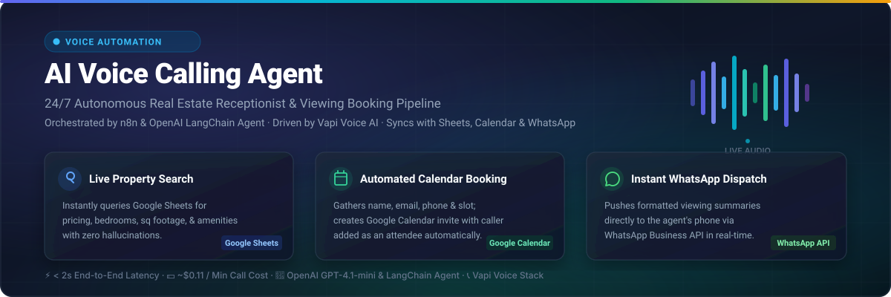
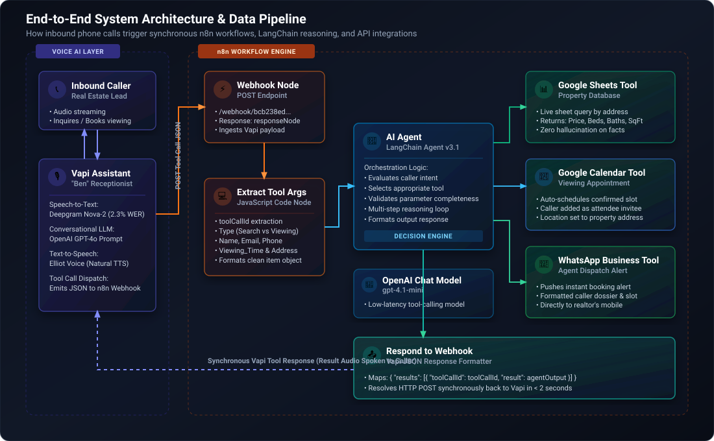
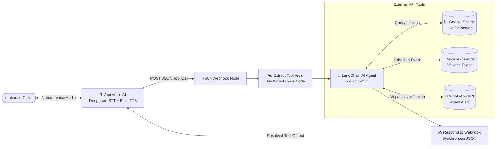
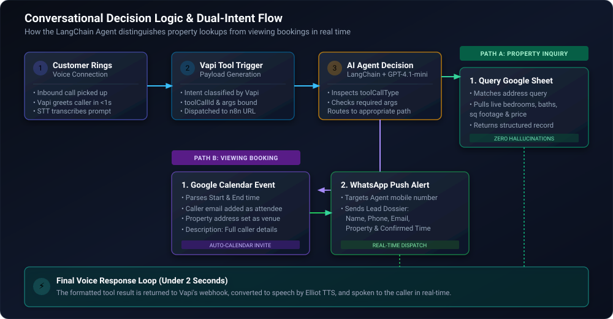

<div align="center">

  

  <br />
  <br />

  [](https://n8n.io)
  [](https://vapi.ai)
  [](https://openai.com)
  [](https://workspace.google.com)
  [](https://developers.facebook.com/docs/whatsapp)
  [](LICENSE)

  <p align="center">
    <strong>An autonomous, 24/7 AI voice receptionist designed for real estate businesses.</strong><br />
    Answers buyer questions instantly from live Google Sheets listings, captures lead contact information, schedules calendar viewings, and dispatches real-time WhatsApp alerts to the agent — in under 2 seconds roundtrip.
  </p>

  <p align="center">
    <a href="#highlights">Highlights</a> •
    <a href="#architecture">Architecture</a> •
    <a href="#how-it-works">How It Works</a> •
    <a href="#call-walkthrough">Call Walkthrough</a> •
    <a href="#workflow-nodes">Workflow Nodes</a> •
    <a href="#deployment-setup">Deploy & Setup</a> •
    <a href="#vapi-schema">Vapi Schema</a>
  </p>

</div>

---

<a id="highlights"></a>
## ⚡ Highlights at a Glance

| Metric / Capability | Value | Why It Matters |
| :--- | :--- | :--- |
| **Response Latency** | **< 2.0s** average turn time | Real humans stay engaged without awkward silence or delays |
| **Operational Cost** | **~$0.11 / min** blended call cost | Replaces $3,000+/mo receptionist overhead with scalable pay-per-use AI |
| **Availability** | **24/7 / 365** zero downtime | Eliminates missed evening and weekend leads when 62% of home searches happen |
| **Inventory Accuracy** | **100% live sync** via Google Sheets | Zero LLM hallucinations — data is queried live from your active listings sheet |
| **Booking Automation** | **Google Calendar + Attendee Invite** | Auto-creates appointments and emails calendar invites to the lead instantly |
| **Agent Push Alert** | **Instant WhatsApp Dispatch** | Agent receives the lead's name, phone, email, property, and confirmed viewing slot |

---

## 💡 The Problem & The Solution

```
THE REAL ESTATE PROBLEM                               OUR AI AGENT SOLUTION
┌───────────────────────────────────────────────┐     ┌───────────────────────────────────────────────┐
│ 📵 62% of calls occur after business hours   │     │ ⚡ Picks up on the first ring 24/7/365         │
│ ⏳ Leads call competitors if put on voicemail │ ──► │ 🔍 Answers specific property queries live    │
│ 📋 Manual appointment booking is slow & leaky │     │ 📅 Gathers contact info & books Google Cal    │
│ 💬 Agents spend 3+ hours daily on receptionist│     │ 📱 Pings agent on WhatsApp with hot lead data │
└───────────────────────────────────────────────┘     └───────────────────────────────────────────────┘
```

---

<a id="architecture"></a>
## 🏗️ System Architecture

The pipeline pairs **Vapi** (telephony, speech transcription, text-to-speech) with **n8n** (workflow automation, LangChain AI agent reasoning, and third-party APIs).

<div align="center">
  
</div>

### Interactive Component Diagram



---

<a id="how-it-works"></a>
## 🔄 How It Works: Dual-Intent Execution

When a caller interacts with the AI receptionist ("Ben"), the conversational engine dynamically handles two main user intents within the same continuous phone conversation:

<div align="center">
  
</div>

### 1. Intent A: Live Property Inquiry
* **Caller asks**: *"Can you tell me more about 123 Skyline Road?"*
* **Trigger**: Vapi emits tool call with `Type = "Property search"` and `Property search details = "123 Skyline Road"`.
* **Execution**: n8n invokes the **Google Sheets Tool**, queries the `Real Estate Properties` document by address, and extracts bedrooms, bathrooms, price, square footage, and description.
* **Output**: Ben speaks the property details back to the caller in natural conversation.

### 2. Intent B: Autonomous Viewing Booking
* **Caller asks**: *"I want to book an in-person viewing this Friday at 3 PM."*
* **Trigger**: Ben gathers the caller's **Full Name**, **Phone Number**, **Email Address**, **Desired Property**, and **Preferred Date & Time**.
* **Execution**:
  1. The **Google Calendar Tool** books an event on the agent's calendar, inserts the property address as the event location, and adds the caller's email as an attendee.
  2. The **WhatsApp Business API Tool** immediately messages the real estate agent's personal WhatsApp with the complete booking dossier.
* **Output**: Ben confirms the appointment details to the caller on the phone and lets them know an email confirmation has been sent.

---

<a id="call-walkthrough"></a>
## 🎙️ Live Call Walkthrough

Here is a step-by-step example of a single, continuous call handled end-to-end:

```
[00:01] 📞 Phone Rings
[00:02] 🤖 Ben (AI): "Thanks for calling Horizon Realty! My name is Ben. 
                      Are you looking to inquire about a listing, or book a viewing today?"
[00:07] 👤 Caller:   "Hi Ben, could you tell me about the house at 123 Skyline Road?"

                      ─── [BACKEND] n8n Webhook Triggered ───
                      • Tool: Google Sheets
                      • Query: "123 Skyline Road"
                      • Result: 4 Bed | 3 Bath | 2,200 sqft | $450,000 | Renovated kitchen
                      ───────────────────────────────────────

[00:09] 🤖 Ben (AI): "That's a fantastic home! It's a 4-bedroom, 3-bathroom property with 
                      2,200 square feet, listed at $450,000. It features an updated kitchen 
                      and an attached 2-car garage. Would you like to schedule an in-person viewing?"
[00:20] 👤 Caller:   "Yes please, how about this Friday at 3 PM?"
[00:24] 🤖 Ben (AI): "I can certainly arrange that! May I have your full name, phone number, 
                      and the best email to send your confirmation to?"
[00:32] 👤 Caller:   "Sarah Jenkins, 555-0199, and sarah.jenkins@example.com."

                      ─── [BACKEND] n8n AI Agent Execution ───
                      • Tool 1: Google Calendar
                        → Event: "Property Viewing - 123 Skyline Road"
                        → Time: Friday 15:00 - 16:00
                        → Attendee: sarah.jenkins@example.com
                      • Tool 2: WhatsApp Business API
                        → To Agent: "+92 318 2227655"
                        → Body: "🚨 New Viewing Confirmed! Sarah Jenkins (555-0199) 
                                 for 123 Skyline Road on Friday at 3:00 PM."
                      ───────────────────────────────────────

[00:35] 🤖 Ben (AI): "You're all confirmed, Sarah! We have you down for 123 Skyline Road this Friday 
                      at 3:00 PM. A calendar invite has been sent to your email, and our local agent 
                      has been notified. Have a wonderful day!"
[00:46] 📞 Call Concluded
```

---

<a id="workflow-nodes"></a>
## 🧩 Workflow Node Breakdown

The entire backend automation is self-contained in [`main-workflow.json`](main-workflow.json). Below is an architectural breakdown of every node in the workflow:

| Node Name | Node Type | Version | Role in the Pipeline |
| :--- | :--- | :--- | :--- |
| **Webhook** | `n8n-nodes-base.webhook` | `2.1` | Listens for inbound `POST` tool call payloads from Vapi. Runs in `responseMode: "responseNode"` to keep the HTTP socket open until the agent completes execution. |
| **Extract Tool Args** | `n8n-nodes-base.code` | `2.0` | Custom JavaScript parser. Normalizes Vapi's `toolCallList`, pulls function arguments (`Type`, `Property search details`, `Name`, `Email`, `Phone`, `Viewing_Time`, `Booking_address`), and passes uniform item attributes. |
| **AI Agent** | `@n8n/n8n-nodes-langchain.agent` | `3.1` | Central reasoning core. Evaluates the normalized request against system prompts to determine whether to query property data, initiate calendar bookings, or dispatch WhatsApp notifications. |
| **OpenAI Chat Model** | `@n8n/n8n-nodes-langchain.lmChatOpenAi` | `1.3` | Powers the LangChain agent with `gpt-4.1-mini` for high-speed, cost-effective parameter extraction and tool routing. |
| **Google Sheets** | `n8n-nodes-base.googleSheetsTool` | `4.7` | Attached as an AI agent tool. Executes structured searches across the `Real Estate Properties` spreadsheet to look up real-time inventory. |
| **Google Calendar** | `n8n-nodes-base.googleCalendarTool` | `1.3` | Attached as an AI agent tool. Generates calendar events with dynamic `start`, `end`, `location`, `description`, and caller `attendees`. |
| **Send message in WhatsApp** | `n8n-nodes-base.whatsAppTool` | `1.1` | Attached as an AI agent tool. Uses Meta WhatsApp Cloud API to message the assigned agent phone number with formatted lead dossiers. |
| **Respond to Webhook** | `n8n-nodes-base.respondToWebhook` | `1.5` | Formats output back into Vapi's expected schema: `{ "results": [{ "toolCallId": "...", "result": "..." }] }` and resolves the HTTP connection. |

---

## 📊 Google Sheets Database Format

The workflow connects to a Google Sheet acting as your live property inventory database. Structure your sheet with the following columns:

| Column | Header Name | Example Value | Description |
| :---: | :--- | :--- | :--- |
| **A** | `Address` | `123 Skyline Road, Austin, TX` | The primary key queried by the voice agent |
| **B** | `Bedrooms` | `4` | Number of bedrooms |
| **C** | `Bathrooms` | `3` | Number of bathrooms |
| **D** | `Price` | `$450,000` | Current listing price |
| **E** | `Square Footage` | `2,200 sq ft` | Total interior square feet |
| **F** | `Status` | `Available` | `Available`, `Pending`, or `Sold` |
| **G** | `Description` | `Updated chef's kitchen, fenced yard, 2-car garage` | Highlights spoken by the voice assistant |

> [!TIP]
> Whenever your listings change, update your Google Sheet directly. The AI agent queries the spreadsheet live on every call — no need to redeploy or re-train anything.

---

<a id="deployment-setup"></a>
## 🚀 Deployment & Setup Guide

### 1. Prerequisites
Ensure you have access to the following accounts before setting up:
- An **[n8n](https://n8n.io/)** instance (n8n Cloud or self-hosted via Docker).
- An **[OpenAI](https://platform.openai.com/)** API account (API key).
- A **[Google Cloud](https://console.cloud.google.com/)** Project with Google Sheets & Google Calendar APIs enabled (OAuth2 credentials).
- A **[Meta for Developers](https://developers.facebook.com/)** account with WhatsApp Business Cloud API configured.
- A **[Vapi](https://vapi.ai/)** account with a provisioned phone number.

---

### 2. Import Workflow into n8n

1. Download or clone this repository:
   ```bash
   git clone https://github.com/Harmain89/ai-voice-calling-agent-n8n.git
   ```
2. In your n8n workspace, navigate to **Workflows** → **Add Workflow** (or press `Ctrl+O` / `Cmd+O`).
3. Click the **three dots (⋮)** in the top right → **Import from File**.
4. Select [`main-workflow.json`](main-workflow.json).
5. The complete workflow canvas with all nodes and connections will load immediately.

---

### 3. Connect Credentials in n8n

Open each tool node in n8n and link your respective credentials:

1. **OpenAI Chat Model**: Select or create an `OpenAI account` credential and paste your OpenAI API key.
2. **Google Sheets Tool**: Connect your `Google Sheets OAuth2` credential and select your `Real Estate Properties` document.
3. **Google Calendar Tool**: Connect your `Google Calendar OAuth2` credential and select the target calendar (e.g. `your-realtor@gmail.com`).
4. **WhatsApp Business Tool**: Link your `WhatsApp account` credential, set the `phoneNumberId`, and verify the recipient agent phone number.

---

### 4. Configure Vapi Assistant & Webhook Tool

In your **Vapi Dashboard** ([dashboard.vapi.ai](https://dashboard.vapi.ai)):

1. **Create an Assistant**:
   - **Name**: `Ben - Real Estate Receptionist`
   - **Voice**: `Elliot` (or any preferred voice provider)
   - **Transcriber**: `Deepgram Nova-2`
   - **Model**: `GPT-4o`

2. **Add Server Webhook URL**:
   - In n8n, open the **Webhook** node, copy the **Production URL**, and paste it into Vapi's Server URL:
     ```
     https://your-n8n-instance.com/webhook/bcb238ed-fc58-4303-8bd6-94366023f289
     ```

3. **Register Custom Tool in Vapi**:
   Add a tool with the exact schema detailed below in [Vapi Tool Specification](#-vapi-tool-specification).

4. **Activate & Test**:
   - Click **Save** in Vapi.
   - Toggle **Active** to `ON` in n8n.
   - Dial your Vapi number and test both property queries and booking viewings!

---

<a id="vapi-schema"></a>
## 📋 Vapi Tool Specification

Below is the JSON schema configuration to register in Vapi so it correctly passes structured data into the n8n webhook:

```json
{
  "type": "function",
  "function": {
    "name": "real_estate_tool",
    "description": "Handles live property searches and schedules in-person viewing appointments.",
    "parameters": {
      "type": "object",
      "properties": {
        "Type": {
          "type": "string",
          "enum": ["Property search", "Viewing booking"],
          "description": "Indicates whether the caller is looking up a property or booking a viewing."
        },
        "Property search details": {
          "type": "string",
          "description": "The property address, street name, or unit the user is inquiring about."
        },
        "Name": {
          "type": "string",
          "description": "Full name of the caller booking the viewing."
        },
        "Email": {
          "type": "string",
          "description": "Email address of the caller to send calendar invite to."
        },
        "Phone": {
          "type": "string",
          "description": "Contact phone number of the caller."
        },
        "Viewing_Time": {
          "type": "string",
          "description": "The requested date and time for the viewing (e.g. '2026-10-02T15:00:00Z' or 'Friday at 3 PM')."
        },
        "Booking_address": {
          "type": "string",
          "description": "The physical address of the property to be viewed."
        }
      },
      "required": ["Type"]
    }
  }
}
```

### Expected Synchronous Response from n8n

Vapi expects tool calls to return the following structure within the webhook timeout window:

```json
{
  "results": [
    {
      "toolCallId": "call_abc123xyz",
      "result": "The viewing for 123 Skyline Road has been scheduled for Friday at 3:00 PM. A calendar invite was emailed to sarah.jenkins@example.com."
    }
  ]
}
```

---

## 🏢 Adaptable Across Other Industries

While built for real estate, this exact architectural pattern can be deployed across any service business that requires phone inquiries and appointment bookings:

* 🩺 **Medical & Dental Clinics**: Check doctor availability, verify accepted insurances, and book patient consultations.
* ⚖️ **Law Firms**: Conduct initial lead intake, screen practice areas, and book discovery sessions.
* 🚗 **Automotive Repair**: Provide service quotes, check bay availability, and schedule vehicle drop-offs.
* 💇 **Salons & Spas**: Check stylist schedules, describe treatment packages, and book appointments.

---

## 📂 Repository File Tree

```
ai-voice-calling-agent-n8n/
│
├── .gitignore                   # Curated ignore rules for secrets, DBs & audio
├── LICENSE                      # MIT License
├── README.md                    # Main repository documentation & guide
├── main-workflow.json           # Ready-to-import n8n workflow file
│
└── docs/
    ├── README.md                # Documentation backup
    ├── README.txt               # Plain text overview
    └── assets/
        ├── banner.svg           # High-resolution vector project banner
        ├── architecture-diagram.svg  # End-to-end system architecture diagram
        └── call-flow.svg        # Dual-intent conversational decision flowchart
```

---

## 🔒 Security Best Practices

* **No Hardcoded Secrets**: Keep all API keys, OAuth refresh tokens, and webhook secrets inside n8n's encrypted credential vault.
* **Pre-configured `.gitignore`**: The repository includes a strict [`.gitignore`](.gitignore) that prevents accidental commits of `.env` files, SQLite databases, Google service account keys, and call recordings.
* **HTTPS Only**: Ensure your n8n webhook endpoint is served over secure HTTPS with a valid SSL/TLS certificate.

---

## 🤝 Contributing

Contributions, feedback, and issue reports are very welcome!

1. Fork the Project.
2. Create your Feature Branch (`git checkout -b feature/AmazingFeature`).
3. Commit your Changes (`git commit -m 'Add some AmazingFeature'`).
4. Push to the Branch (`git push origin feature/AmazingFeature`).
5. Open a Pull Request.

---

## 📄 License

This project is licensed under the **MIT License** — see the [LICENSE](LICENSE) file for details. Free for both personal and commercial use.

---

## 📬 Contact & Custom Builds

Built with passion by **Harmain Rizwan** — AI Automation Developer specializing in voice agents, n8n workflows, and conversational AI systems.

> **Need a customized AI voice agent for your business?**  
> Available for custom agent builds, CRM integrations (HubSpot, GoHighLevel, Salesforce), and white-label deployments on [Upwork](https://www.upwork.com).
