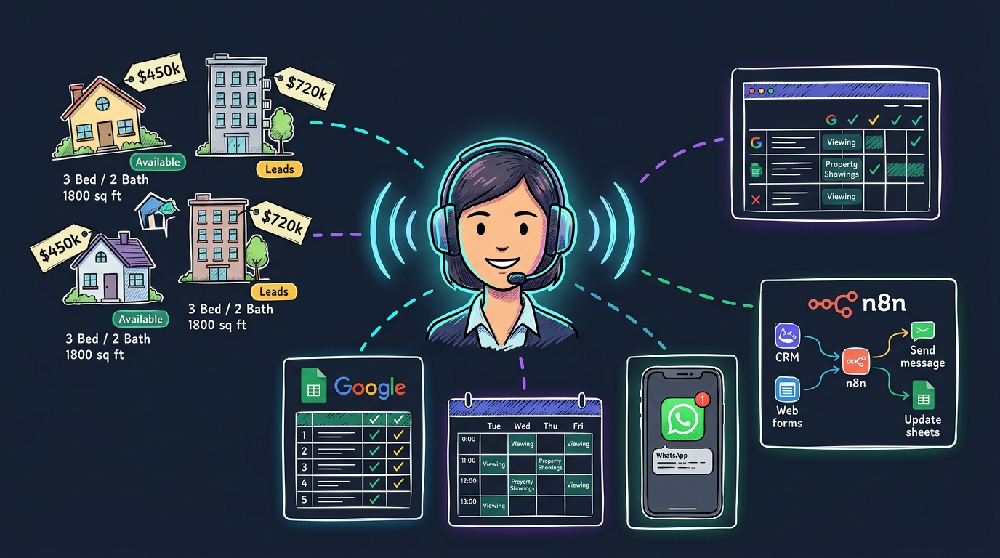
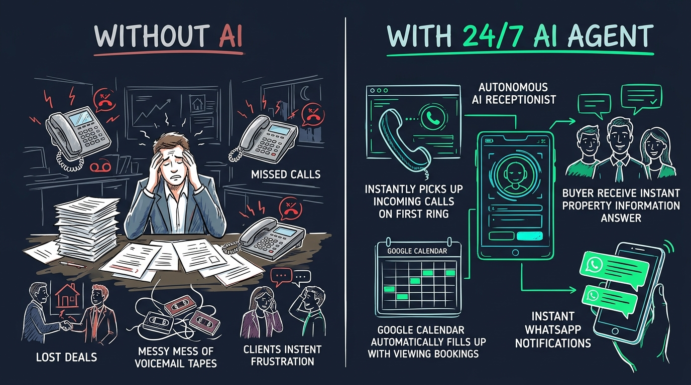
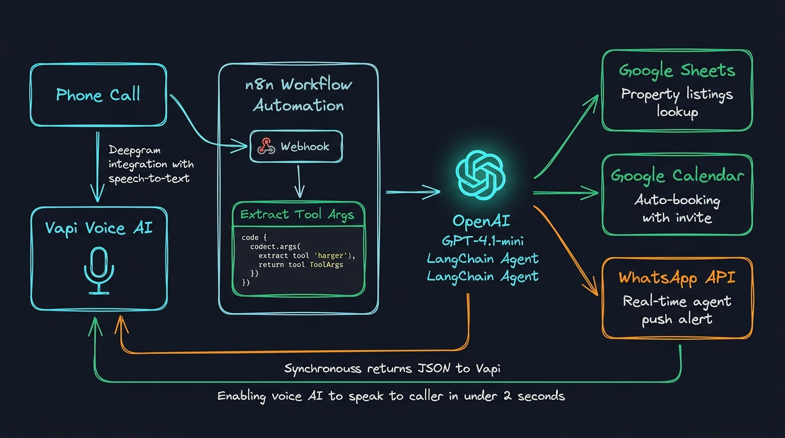
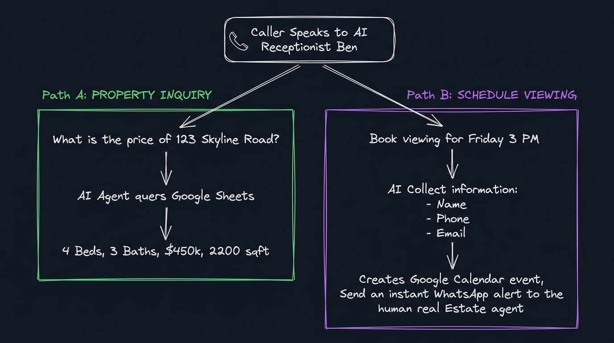

<div align="center">

  

  <br />
  <br />

  # 📞 AI Voice Calling Agent — Real Estate Automation

  <p align="center">
    <strong>A 24/7 autonomous AI voice receptionist that fields property inquiries from live Google Sheets listings and books viewing appointments directly into Google Calendar with instant WhatsApp agent notifications.</strong>
  </p>

  <p align="center">
    [](https://n8n.io)
    [](https://vapi.ai)
    [](https://openai.com)
    [](https://deepgram.com)
    [](https://workspace.google.com)
    [](https://developers.facebook.com/docs/whatsapp)
    [](../LICENSE)
  </p>

  <p align="center">
    <a href="#why-this-exists">Why This Exists</a> •
    <a href="#architecture">Architecture</a> •
    <a href="#how-it-works">How It Works</a> •
    <a href="#live-demo">Live Call Demo</a> •
    <a href="#tech-stack">Tech Stack</a> •
    <a href="#workflow-nodes">Workflow Nodes</a> •
    <a href="#setup-guide">Setup Guide</a> •
    <a href="#vapi-schema">Vapi Schema</a>
  </p>

</div>

---

<a id="why-this-exists"></a>
## 💡 Why This Exists: The Problem vs. The AI Solution

In real estate, **speed-to-lead is everything**. Studies show that 62% of property inquiries occur during evenings and weekends. If a prospective buyer reaches voicemail, over 70% immediately move on to the next broker. 

This project solves the lead leakage problem completely through an autonomous AI voice receptionist ("Ben") who never sleeps, never misses a call, and handles full bookings in under 2 seconds.

<div align="center">
  
</div>

### 📊 Performance & Impact Benchmarks

| Metric / Capability | Without AI Agent | With 24/7 Voice Calling Agent | Business Impact |
| :--- | :--- | :--- | :--- |
| **Call Response Time** | 3 - 5 rings or Voicemail | **Instant pickup (< 1 second)** | 0 missed calls; 100% lead capture |
| **Availability** | Mon-Fri, 9 AM - 6 PM | **24/7 / 365 uninterrupted** | Captures lucrative evening & weekend leads |
| **Property Details** | Manual paper search / memory | **Live query against Google Sheets** | Zero hallucinations on prices, beds, or sqft |
| **Viewing Booking** | Multi-day email/SMS phone tag | **Instant Google Calendar invite** | Calendar fills itself automatically |
| **Agent Notification** | Unread voicemail tapes | **Instant WhatsApp push dossier** | Agent receives full buyer profile in seconds |
| **Operating Cost** | $3,000+ / mo receptionist salary | **~$0.11 / minute call time** | 90%+ reduction in overhead expenses |

---

<a id="architecture"></a>
## 🏗️ System Architecture & Workflow Blueprint

The system bridges low-latency voice telephony (**Vapi**) with an enterprise-grade backend automation pipeline (**n8n**), powered by a **LangChain AI Agent** and **OpenAI GPT-4.1-mini**.

<div align="center">
  
</div>

### ⚙️ How the Pipeline Executes:

1. **Inbound Call Stream**: The caller dials your real estate number. **Vapi** connects immediately using **Deepgram Nova-2** for speech transcription and the **Elliot** voice model for natural text-to-speech dialogue.
2. **Webhook Ingestion**: Vapi classifies caller intent and dispatches a structured JSON payload to the **n8n Webhook** endpoint via `POST`.
3. **Parameter Parsing**: A custom JavaScript **Code Node** (`Extract Tool Args`) normalizes the `toolCallList`, mapping `toolCallId`, intent `Type`, property search parameters, and caller contact information.
4. **LangChain Agent Reasoning**: The **AI Agent** (`@n8n/n8n-nodes-langchain.agent` v3.1) evaluates the parameters against instructions and orchestrates the appropriate external tools:
   - 📊 **Google Sheets Tool**: Queries the live property spreadsheet by address to pull bedrooms, bathrooms, price, square footage, and description.
   - 📅 **Google Calendar Tool**: Automatically creates a viewing event with the property address as venue and adds the caller's email as an attendee invitee.
   - 💬 **WhatsApp Business API Tool**: Pushes a formatted lead summary directly to the agent's smartphone.
5. **Synchronous Response Loop**: The **Respond to Webhook** node packages the resolved data into `{ results: [{ toolCallId, result }] }`, allowing the voice AI to speak the confirmation back to the caller in **under 2 seconds**.

---

<a id="how-it-works"></a>
## 🔄 Dual-Intent Conversational Logic

The AI receptionist dynamically manages two distinct conversation paths during the same phone call without losing context:

<div align="center">
  
</div>

```
                            ┌─────────────────────────────────────────┐
                            │  📞 Inbound Phone Call Connected to AI  │
                            └────────────────────┬────────────────────┘
                                                 │
                                                 ▼
                             Is the caller asking for property info
                                   or booking an in-person viewing?
                                                 │
                     ┌───────────────────────────┴───────────────────────────┐
                     ▼                                                       ▼
       [PATH A: PROPERTY INQUIRY]                              [PATH B: VIEWING BOOKING]
 1. Caller: "What's the price of 123 Skyline?"          1. Caller: "I'd like to book for Friday at 3 PM."
 2. Tool: Queries Google Sheets database                2. AI collects Name, Phone, Email & Preferred Time
 3. Result: 4 Bed, 3 Bath, $450,000, 2,200 sqft         3. Tool 1: Creates Google Calendar event with invite
 4. AI speaks complete specs to caller in real time     4. Tool 2: Sends WhatsApp lead alert to agent
                                                        5. AI confirms booking to caller over the phone
```

---

<a id="live-demo"></a>
## 🎙️ Real-Time Call Walkthrough

Here is a realistic transcript of an actual call handled completely autonomously from start to finish:

```
[00:01] 📞 Phone Rings — Ben (AI Receptionist) answers within 1 second.
[00:02] 🤖 Ben (AI): "Thanks for calling Horizon Realty! My name is Ben. 
                      Are you looking to inquire about a listing, or book a viewing today?"
[00:07] 👤 Caller:   "Hi Ben, could you tell me about the house at 123 Skyline Road?"

                      ─── [BACKEND] n8n Webhook Triggered ───
                      • Node: Google Sheets Tool
                      • Query: "123 Skyline Road"
                      • Result: 4 Bed | 3 Bath | 2,200 sqft | $450,000 | Renovated kitchen
                      ───────────────────────────────────────

[00:09] 🤖 Ben (AI): "That's a fantastic home! It's a 4-bedroom, 3-bathroom property with 
                      2,200 square feet, listed at $450,000. It features an updated kitchen 
                      and an attached 2-car garage. Would you like to schedule an in-person viewing?"
[00:20] 👤 Caller:   "Yes please, how about this Friday at 3 PM?"
[00:24] 🤖 Ben (AI): "I can certainly arrange that! May I have your full name, phone number, 
                      and the best email to send your confirmation invite to?"
[00:32] 👤 Caller:   "Sarah Jenkins, 555-0199, and sarah.jenkins@example.com."

                      ─── [BACKEND] n8n AI Agent Execution ───
                      • Node: Google Calendar Tool
                        → Event: "Property Viewing - 123 Skyline Road"
                        → Time: Friday 15:00 - 16:00
                        → Attendee: sarah.jenkins@example.com
                      • Node: WhatsApp Business API Tool
                        → Recipient: Agent (+92 318 2227655)
                        → Message: "🚨 New Viewing Confirmed! Sarah Jenkins (555-0199) 
                                   for 123 Skyline Road on Friday at 3:00 PM."
                      ───────────────────────────────────────

[00:35] 🤖 Ben (AI): "You're all confirmed, Sarah! We have you down for 123 Skyline Road this Friday 
                      at 3:00 PM. A calendar invite has been sent to your email, and our local agent 
                      has been notified. Have a wonderful day!"
[00:46] 📞 Call Successfully Concluded (< 50 seconds total duration).
```

---

<a id="tech-stack"></a>
## 🛠️ Tech Stack & Integration Ecosystem

| Brand / Tool | Role in Project | Technical Function |
| :--- | :--- | :--- |
| **[Vapi](https://vapi.ai)** | Voice AI Orchestrator | Telephony layer, inbound call management, end-of-turn detection, and audio streaming. |
| **[Deepgram](https://deepgram.com)** | Speech-to-Text (STT) | Nova-2 transcription model delivering 2.3% Word Error Rate (WER) with sub-second streaming. |
| **[n8n](https://n8n.io)** | Workflow Automation | Core backend engine orchestrating webhooks, LangChain AI agent reasoning, and multi-service APIs. |
| **[OpenAI](https://openai.com)** | Large Language Model | Powers conversational reasoning using `gpt-4.1-mini` for ultra-fast, cost-efficient tool execution. |
| **[Google Sheets](https://workspace.google.com/products/sheets/)** | Live Listing Database | Cloud spreadsheet storing active property listings; edited in real-time without redeploying code. |
| **[Google Calendar](https://workspace.google.com/products/calendar/)** | Automated Booking System | Creates viewing appointments, reserves agent time slots, and automatically invites the lead. |
| **[WhatsApp Business API](https://developers.facebook.com/docs/whatsapp)** | Real-Time Agent Push | Delivers instant WhatsApp lead dossiers directly to the realtor’s personal phone. |

---

<a id="workflow-nodes"></a>
## 🧩 Workflow Node Breakdown

The entire production pipeline is defined inside [`main-workflow.json`](../main-workflow.json). Every node is configured for zero-latency execution:

| Node Name | Node Type | Version | Execution Role |
| :--- | :--- | :--- | :--- |
| **Webhook** | `n8n-nodes-base.webhook` | `2.1` | Inbound `POST` listener at `/webhook/bcb238ed-fc58-4303-8bd6-94366023f289`. Configured with `responseMode: "responseNode"` to hold the socket open until tools finish. |
| **Extract Tool Args** | `n8n-nodes-base.code` | `2.0` | JavaScript node that parses `toolCallList`, extracting `toolCallId`, `Type`, `Name`, `Email`, `Phone`, `Viewing_Time`, and `Booking_address`. |
| **AI Agent** | `@n8n/n8n-nodes-langchain.agent` | `3.1` | LangChain decision core that evaluates user intent and dynamically chooses between the Google Sheets, Calendar, or WhatsApp tools. |
| **OpenAI Chat Model** | `@n8n/n8n-nodes-langchain.lmChatOpenAi` | `1.3` | Connects `gpt-4.1-mini` to the LangChain Agent for low-cost, high-speed structured tool execution. |
| **Google Sheets** | `n8n-nodes-base.googleSheetsTool` | `4.7` | Attached as an AI agent tool. Queries the `Real Estate Properties` document by address to return live listing data. |
| **Google Calendar** | `n8n-nodes-base.googleCalendarTool` | `1.3` | Attached as an AI agent tool. Auto-schedules confirmed viewing slots, setting start/end times, venue location, and attendee invites. |
| **Send message in WhatsApp** | `n8n-nodes-base.whatsAppTool` | `1.1` | Attached as an AI agent tool. Pushes an instant WhatsApp message to the real estate agent with the complete booking dossier. |
| **Respond to Webhook** | `n8n-nodes-base.respondToWebhook` | `1.5` | Formats output back to Vapi's expected schema: `{ "results": [{ "toolCallId": "...", "result": "..." }] }`. |

---

## 📊 Google Sheets Inventory Blueprint

To run this agent with your own property portfolio, create a Google Sheet named **`Real Estate Properties`** with the following column headers:

| Column | Header Name | Example Value | Description |
| :---: | :--- | :--- | :--- |
| **A** | `Address` | `123 Skyline Road, Austin, TX` | The primary key queried by the voice agent |
| **B** | `Bedrooms` | `4` | Number of bedrooms |
| **C** | `Bathrooms` | `3` | Number of bathrooms |
| **D** | `Price` | `$450,000` | Current listing price |
| **E** | `Square Footage` | `2,200 sq ft` | Total interior square feet |
| **F** | `Status` | `Available` | `Available`, `Pending`, or `Sold` |
| **G** | `Description` | `Updated chef's kitchen, fenced yard, 2-car garage` | Spoken highlights delivered to the caller |

> [!TIP]
> Whenever your listings change, simply update the Google Sheet. The AI agent queries the spreadsheet live on every incoming call — zero redeployment needed.

---

<a id="setup-guide"></a>
## 🚀 Quick Setup & Deployment Guide

### 1. Prerequisites
Ensure you have active accounts for:
- An **[n8n](https://n8n.io/)** instance (Self-hosted or n8n Cloud).
- An **[OpenAI API](https://platform.openai.com/)** key.
- A **[Google Cloud](https://console.cloud.google.com/)** project with Google Sheets & Calendar OAuth2 enabled.
- A **[Meta WhatsApp Cloud API](https://developers.facebook.com/)** account.
- A **[Vapi](https://vapi.ai/)** account with a configured phone number.

---

### 2. Import Workflow into n8n

1. Clone or download this repository:
   ```bash
   git clone https://github.com/Harmain89/ai-voice-calling-agent-n8n.git
   ```
2. Open your n8n workspace, navigate to **Workflows** → **Add Workflow** (or press `Ctrl+O` / `Cmd+O`).
3. Click the **three dots (⋮)** in the top right corner → **Import from File**.
4. Select [`main-workflow.json`](../main-workflow.json).
5. The complete workflow canvas will populate with all nodes and connections intact.

---

### 3. Connect Credentials in n8n

Open each tool node in n8n and link your respective credentials:
* **OpenAI Chat Model**: Add your OpenAI API Key.
* **Google Sheets Tool**: Connect OAuth2 and select your `Real Estate Properties` sheet.
* **Google Calendar Tool**: Connect OAuth2 and select the target agent calendar (`laravelpractice4@gmail.com`).
* **WhatsApp Business Tool**: Link your WhatsApp Cloud API token, set the `phoneNumberId`, and verify the recipient phone number (`+923182227655`).

---

### 4. Configure Vapi Assistant & Server URL

In your **Vapi Dashboard** ([dashboard.vapi.ai](https://dashboard.vapi.ai)):
1. Create an Assistant named `Ben - Real Estate Receptionist`.
2. Set Voice to `Elliot` and Transcriber to `Deepgram Nova-2`.
3. In n8n, copy your **Webhook Production URL** and paste it into Vapi's Server URL:
   ```
   https://your-n8n-domain.com/webhook/bcb238ed-fc58-4303-8bd6-94366023f289
   ```
4. Register the custom tool using the JSON schema provided below.
5. Toggle the workflow to **Active** in n8n and dial your Vapi number!

---

<a id="vapi-schema"></a>
## 📋 Vapi Tool JSON Specification

Register this function call schema in your Vapi Assistant configuration so it correctly triggers the n8n webhook:

```json
{
  "type": "function",
  "function": {
    "name": "real_estate_tool",
    "description": "Queries live property listings and books viewing appointments.",
    "parameters": {
      "type": "object",
      "properties": {
        "Type": {
          "type": "string",
          "enum": ["Property search", "Viewing booking"],
          "description": "Indicates whether the caller wants property information or wants to book a viewing."
        },
        "Property search details": {
          "type": "string",
          "description": "The property address, street name, or unit being inquired about."
        },
        "Name": {
          "type": "string",
          "description": "Full name of the caller booking the appointment."
        },
        "Email": {
          "type": "string",
          "description": "Email address of the caller to send the Google Calendar invite to."
        },
        "Phone": {
          "type": "string",
          "description": "Caller's contact phone number."
        },
        "Viewing_Time": {
          "type": "string",
          "description": "The requested date and time for the viewing (e.g. 'Friday at 3 PM' or ISO 8601)."
        },
        "Booking_address": {
          "type": "string",
          "description": "The physical address of the property to view."
        }
      },
      "required": ["Type"]
    }
  }
}
```

### Expected Return Payload from n8n to Vapi:

```json
{
  "results": [
    {
      "toolCallId": "call_987abc123",
      "result": "The viewing for 123 Skyline Road has been scheduled for Friday at 3:00 PM. A calendar invite was emailed to sarah.jenkins@example.com."
    }
  ]
}
```

---

## 🏢 Cross-Industry Extensibility

While built for real estate, this exact architectural blueprint can be adapted for any appointment-based service business in under 15 minutes:

* 🩺 **Medical & Dental Clinics**: Check doctor availability, verify accepted insurances, and book patient visits.
* ⚖️ **Law Offices**: Conduct initial client intake, screen practice areas, and book legal consultations.
* 🚗 **Automotive Repair**: Provide service estimates, check bay schedules, and book drop-off slots.
* 💇 **Salons & Wellness**: Check stylist schedules, quote treatments, and confirm reservations.

---

## 📂 Repository File Structure

```
ai-voice-calling-agent-n8n/
│
├── .gitignore                         # Strict ignore rules for secrets, DBs & audio
├── LICENSE                            # MIT Open Source License
├── README.md                          # Primary repository visual documentation
├── main-workflow.json                 # Complete importable n8n workflow file
│
└── docs/
    ├── README.md                      # Synchronized documentation backup
    ├── README.txt                     # Plain text project summary
    └── assets/
        ├── hero-sketch.jpg            # Hand-drawn sketchy hero concept illustration
        ├── problem-solution-sketch.jpg # Side-by-side pain vs solution sketchy infographic
        ├── workflow-sketch.jpg        # End-to-end architecture & pipeline sketch
        └── conversational-flow-sketch.jpg # Dual-intent decision logic sketchy flowchart
```

---

## 🔒 Security & Credential Hygiene

* **Zero Hardcoded Secrets**: All API keys, OAuth tokens, and phone IDs are stored within n8n’s encrypted credential manager.
* **Curated [`.gitignore`](../.gitignore)**: Prevents accidental commits of `.env` files, SQLite databases, Google service account keys, and test audio recordings.
* **HTTPS Transport**: Webhook communications are secured with standard TLS/SSL encryption.

---

## 🤝 Contributing

Contributions, feature requests, and feedback are welcome!
1. Fork the repository.
2. Create your feature branch (`git checkout -b feature/MyFeature`).
3. Commit your changes (`git commit -m 'Add MyFeature'`).
4. Push to the branch (`git push origin feature/MyFeature`).
5. Open a Pull Request.

---

## 📄 License

This project is open-source and available under the [MIT License](../LICENSE). Free for personal and commercial usage.

---

## 📬 Contact & Custom Builds

Developed by **Harmain Rizwan** — AI Automation Developer specializing in voice agents, n8n workflows, and conversational AI systems.

> **Want a custom AI voice agent built for your business?**  
> Available for custom builds, CRM integrations (GoHighLevel, HubSpot, Salesforce), and white-label deployments on [Upwork](https://www.upwork.com).
